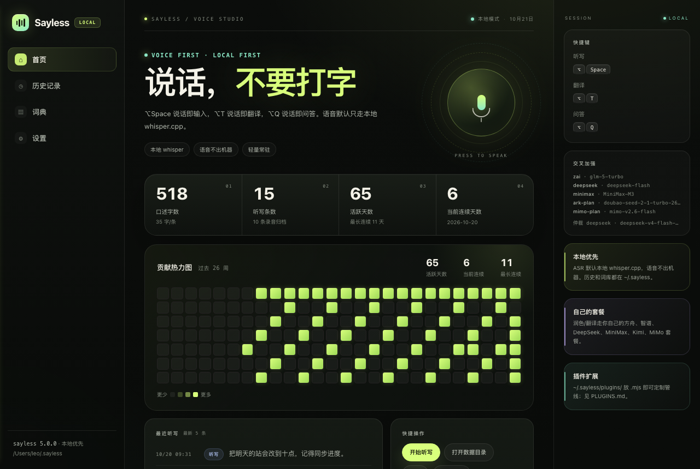
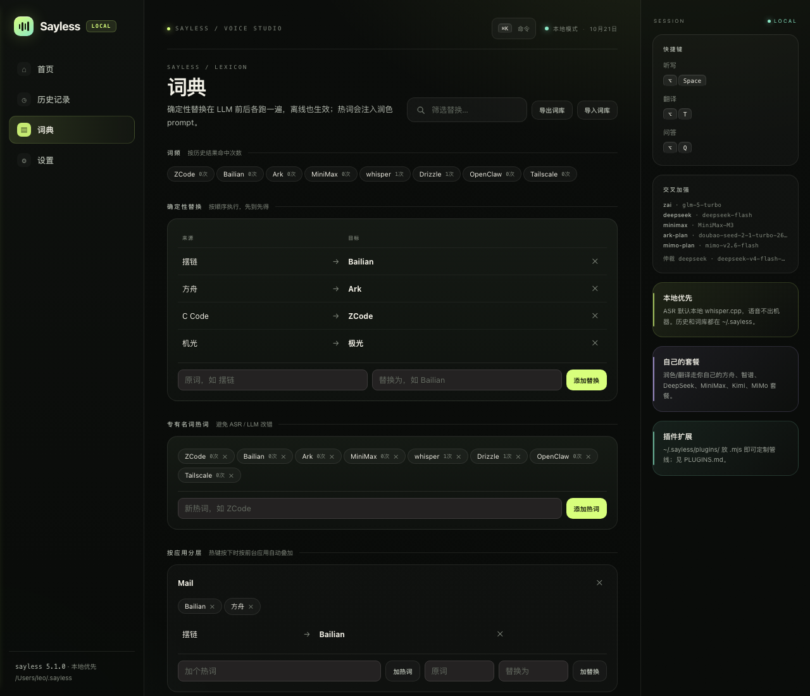
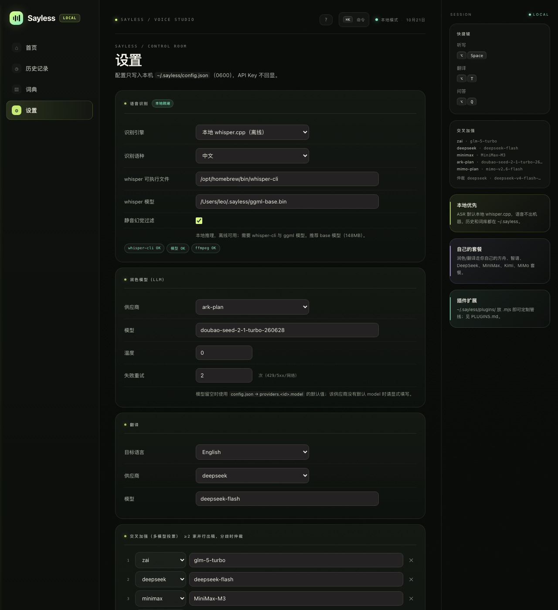
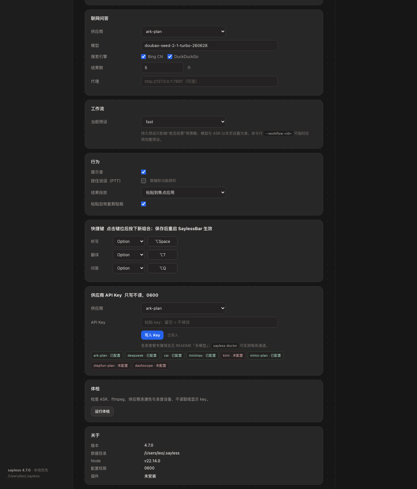
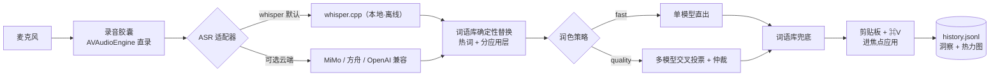
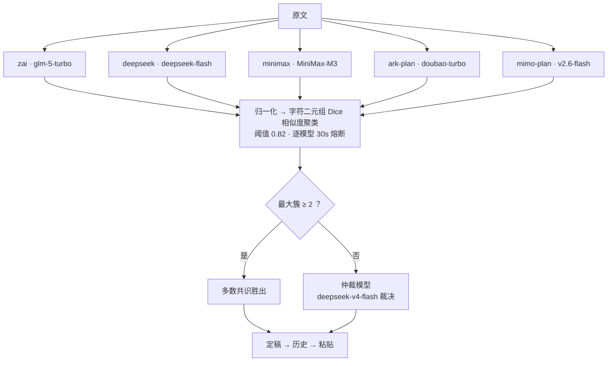
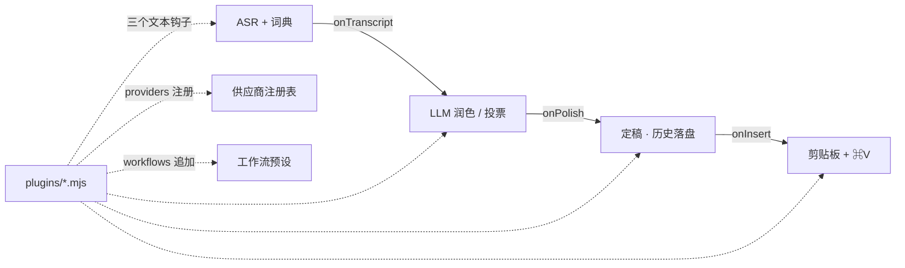

# Sayless

> ⚠️ **声明**：本项目是对 Typeless 应用进行**逆向工程的学习项目**，交互形态按 1:1 复刻仅作学习研究之用，**切勿用于任何商业用途**（详见 [LICENSE](LICENSE)）。与 Typeless 原开发者无任何隶属或授权关系。

**本地优先的中文语音听写 / 翻译 / 问答管线**——录音 → 语音识别 → 词语库 → 多模型润色 → 粘贴进焦点应用，配上一个 Typeless 风格的菜单栏 App。

干净的自研实现（不含任何第三方听写应用代码），模型走**你自己的套餐**，词语库和听写历史全部本地。

```
麦克风 ──▶ ASR（本地 whisper.cpp / MiMo 云端）──▶ 词语库确定性替换
      ──▶ LLM 润色（单模型或 N 家交叉投票）──▶ 词语库兜底 ──▶ 剪贴板 + ⌘V
```

## 界面速览

<p align="center">
  <br/>
  <sub>录音胶囊：✕ 取消 · 实时波形 · ✓ 完成 —— Typeless 1:1 形态</sub>
</p>

| 首页：洞察 + 贡献热力图 | 词典：可视化编辑 + 分应用词层 |
|---|---|
|  |  |
| **设置：ASR / 润色模型 / 交叉阵容 / 翻译** | **设置：工作流 / 行为 / 快捷键** |
|  |  |

## 特性一览

- **⌥Space 说话即打字**：菜单栏常驻，按住热键说话，松手文本自动润色并粘贴进当前焦点应用；⌥T 说话即翻译、⌥Q 说话即联网问答，键位可在 config 里改
- **本地优先**：ASR 默认本地 whisper.cpp（Metal 加速，8s 语音约 1s 转完），语音不出机器
- **多模型交叉投票**：5 家模型并行出稿 → 字符二元组相似度聚类 → 多数共识取胜，全分歧时仲裁模型裁决，实战全票率极高
- **个性化词语库**：专有名词保护、确定性替换、风格规则、按前台应用自动叠加分应用词层
- **自我学习**：`sayless learn` 对比原文/改稿自动生成词条，`--mine` 从历史挖掘高频修正
- **完全可定制**：`~/.sayless/plugins/` 放一个 `.mjs` 即可接管管线任意环节（见 [PLUGINS.md](PLUGINS.md)）
- **菜单栏面板（hub）**：洞察统计 + 贡献热力图 / 可搜索历史 / 可视化词典 / 完整设置页，Typeless 1:1 布局



## 与 Typeless 对比

本项目是 Typeless 的**逆向学习项目**：通过对其 2.8.1 版本的行为观察与本机分析，学习一款成熟听写产品的交互设计与工程形态，并按 1:1 复刻交互（浮条与 hub），代码为**完全独立的干净实现**（不含其任何代码与资源）。逆向过程中沉淀的差异（对比基于 Typeless 2.8.1 公开行为与本机观察，2026-10）：

| 维度 | Typeless | Sayless |
|---|---|---|
| 定位 | 商业订阅产品 | 逆向学习项目（非商用，软件免费） |
| 模型费用 | 订阅费内含 | 走**你自己的套餐**（方舟 / 智谱 / DeepSeek / Kimi / MiMo…），花多少看得到 |
| 语音识别 | 云端 ASR，语音上传服务方 | 默认**本地 whisper.cpp 离线**，语音不出机器；可切 MiMo / 方舟云端 |
| 质量机制 | 单一管线 + 服务端质量网关 | 客户端 **5 家模型交叉投票 + 仲裁**，每条听写都是多数派共识 |
| 个性化 | 自定义词表 | 确定性替换 + 风格规则 + **按前台应用分层** + `learn` 自动学习闭环 |
| 扩展性 | 闭源，不可扩展 | **插件 API**：3 个管线钩子 + 自定义供应商 + 自定义工作流 |
| 数据归属 | 听写历史存于服务方 | 全部本地：历史 / 词库 / 反馈都在 `~/.sayless/`，随时导出删除 |
| 透明度 | 闭源 | 源码可审计；每个模型端点可 `sayless doctor` 实测连通与鉴权 |
| 交互形态 | 浮条 + hub 面板 | 同形态 1:1（✕/波形/✓ 胶囊、洞察 + 热力图 hub、四页导航） |
| 平台 | macOS | macOS，CLI 与菜单栏 App 可完全独立使用 |

一句话：**Typeless 卖的是省心，Sayless 给的是控制权**——模型、数据、词库、管线每一环都握在自己手里。再次强调：本项目仅作逆向学习之用，**切勿商用**。

## 快速开始

```sh
# 依赖：Node 18+，whisper.cpp（brew install whisper-cpp），ffmpeg（录音设备探测用）
git clone https://github.com/LeoLin990405/sayless.git && cd sayless
ln -sf "$PWD/sayless.mjs" /opt/homebrew/bin/sayless

sayless init          # 生成 ~/.sayless/{config.json, dictionary.json}

# 下载 whisper 基座模型（148MB，必下；网络不畅可把域名换成 hf-mirror.com 镜像）
mkdir -p ~/.sayless && curl -L -o ~/.sayless/ggml-base.bin \
  https://huggingface.co/ggerganov/whisper.cpp/resolve/main/ggml-base.bin

sayless doctor        # 体检：ASR/链路/各家供应商 key/录音设备（模型缺失会标注）
sayless run           # 说话，回车停止 → 转写+润色+粘贴
```

菜单栏 App（可选但推荐）：

```sh
cd app && ./build.sh  # swiftc 编译 + 代码签名 + 安装 /Applications 并启动
```

首次使用授权两次（都给 SaylessBar）：**麦克风**、**辅助功能**（热键与粘贴）。

## SaylessBar 菜单栏 App

- **录音胶囊**：屏幕底部浮出黑胶囊（✕ / 实时波形 / ✓），Thinking 态与结果预览 3.5s 自隐，Esc 取消，90s 自动收尾
- **hub 四页**：首页（口述字数/条数/活跃天/连续天 + 20 周热力图）｜历史记录（搜索）｜词典（替换/热词/词频/分应用层可视化编辑）｜设置（见下）
- **设置页**：ASR 引擎、润色供应商+模型、交叉阵容、翻译语种、工作流、提示音/PTT/结果投放，以及**供应商 API Key 写入**（密码框不回显，key 只落本地 config.json 0600）——保存深合并写回 config.json
- **键位**：config.json `"hotkeys"` 里 slot（dictate/translate/ask）+ key（macOS 键码）+ modifier，改完重启 App 生效
- **菜单**：打开主面板 / 历史 / 设置 / 紧急停止录音 / 请求辅助功能授权 / 登录启动 / 词语库 / 日志

构建与签名：

- `app/build.sh` 自动检测钥匙串里的 `Sayless Local Dev` 证书并以其签名——**TCC 授权（辅助功能/麦克风）跨重装永久保留**；找不到证书则回退 ad-hoc（每次重装需重开辅助功能开关）
- 制作持久证书（一次性，全自动）：`openssl req -x509 -newkey rsa:2048 -nodes -addext "extendedKeyUsage=codeSigning" -subj "/CN=Sayless Local Dev"` 生成 → `security import` → `security add-trusted-cert -p codeSign`（会弹一次 Touch ID/密码确认）
- 调试口子：`SAYLESS_SHOW_HUB=<0-3>` 启动即开对应页面（首页/历史/词典/设置）

## CLI 参考

| 命令 | 说明 |
|---|---|
| `sayless run` | 录音→转写→润色→粘贴。`--sec N` 定长，`--raw` 跳过 LLM，`--no-insert` 只输出，`--translate en` 翻译模式，`--ask` 问答模式，`--workflow quality` 临时切工作流 |
| `sayless rec --sec 5 -o a.wav` | 仅录音（16k mono wav） |
| `sayless asr <file.wav>` | 仅转写（走当前 ASR 适配器） |
| `sayless polish "<text>"` | 只润色。`--dry-run` 只过词语库，`--cross` 强制投票 |
| `sayless translate "<text>" --to ja` | 翻译，8 语种；`--say` 先录音 |
| `sayless ask "<问题>"` | Bing CN + DuckDuckGo 检索 → 带 [n] 引用的回答；`--say` 先录音 |
| `sayless transcribe <wav>` | 转写→润色→粘贴，App 外壳复用此命令；`--force` 绕过短语音守卫 |
| `sayless insert "<text>"` | 手动粘贴任意文本进焦点应用 |
| `sayless dict add\|del\|add-hot\|del-hot\|import\|stats` | 词语库管理；`import` 支持每行 `a=>b` 或纯热词 |
| `sayless learn "<原文>" "<改稿>"` | 智能 diff 自动生成替换规则；`--last` 对比上一条；`--mine` 挖掘高频修正 |
| `sayless history -n 20` | 听写历史 |
| `sayless plugin` | 已加载插件及钩子 |
| `sayless doctor` | 体检：ASR/链路摘要/供应商分组实测（已配 key / 未配 key）/录音设备 |

通用旗标：`--provider <id>`、`--model <id>` 单次切换供应商与模型；`--cross` 强制交叉投票；`--workflow <id>` 临时切预设。

## 多模型

`config.json → providers` 注册任意 OpenAI 兼容供应商（baseUrl + apiKey），内置预设：

| 供应商 | 端点 | 备注 |
|---|---|---|
| `ark-plan` | `ark.cn-beijing.volces.com/api/plan/v3` | 火山方舟 Agent Plan 套餐（豆包系列） |
| `deepseek` | `api.deepseek.com/v1` | |
| `zai` | `open.bigmodel.cn/api/coding/paas/v4` | 智谱 GLM Coding Plan |
| `minimax` | `api.minimaxi.com/v1` | 走非标路径 `chatPath=/text/chatcompletion_v2`（provider 配置支持） |
| `kimi` | `api.kimi.com/coding/v1` | Kimi for Coding（`sk-kimi-` key 专用端点） |
| `qwen-plan` | `token-plan.cn-beijing.maas.aliyuncs.com/compatible-mode/v1` | 阿里 Token Plan（`sk-sp-` key 只认自家 maas 网关） |
| `bailian-ws` | workspace 专属网关 | 百炼工作区，需控制台开通模型 |
| `stepfun` / `stepfun-plan` | `api.stepfun.com/v1` / `/step_plan/v1` | **套餐额度走 `/step_plan` 专用地址**，与按量余额独立；需[实名认证](https://account.stepfun.com/security?action=realname)；仅 `step-router-v1`（输出带脚手架，勿入投票） |
| `mimo` / `mimo-plan` | `api.xiaomimimo.com/v1` / `token-plan-sgp.xiaomimimo.com/v1` | 小米 Token Plan 的 `tp-` key 走专属域名；V2.5 系 chat 模型已下线，用 `mimo-v2.6-flash` |
| `dashscope` / `siliconflow` / `moonshot` / `zhipu` | — | 预设就绪，填 key 即用 |

经验法则：**同一家的"套餐"和"按量"往往是两套额度、两个地址**——402/403 先查是不是打错了通道（`sayless doctor` 一目了然）。

### 交叉投票（`--cross`）



`cross.models` 里每家并行出稿（逐模型 30s 熔断）→ 归一化字符二元组 Dice 相似度聚类（阈值 `similarity: 0.82`）→ 最大簇 ≥2 即共识，全分歧时 `cross.arbiter` 裁决。当前阵容：zai + deepseek + minimax + ark-plan + mimo-plan 五家，实测常全票。

### 工作流

`workflows` 预设一键切整套组合，`activeWorkflow` 为默认，hub 设置页可改，`--workflow` 单次覆盖：

- `fast` — 单模型直出（日常听写推荐，2-3s）
- `quality` — 交叉投票（~15s）
- `cloud` — 云端 ASR + 投票

## 个性化词语库（dictionary.json）

```jsonc
{
  "replacements": [{ "from": "摆链", "to": "Bailian" }],   // 确定性替换，LLM 前后各跑一遍，离线也生效
  "hotwords": ["ZCode", "Bailian"],                        // 专有名词注入 prompt，防 ASR/LLM 瞎改
  "styleRules": ["删除语气词", "技术名词保留英文"],           // 逐条进润色 system prompt
  "apps": { "微信": { "hotwords": ["方舟"] } }              // 按前台应用自动叠加词层
}
```

`sayless learn` 学习闭环：智能 diff 对比原文与改稿生成替换规则 → 写入 feedback.jsonl → `--mine` 挖掘高频模式 → hub 词典页可视化管理。

## 插件（开发口子）

不改源码定制管线：`~/.sayless/plugins/*.mjs` 自动加载，可导出 `onTranscript / onPolish / onInsert` 文本钩子、`providers` 自定义供应商、`workflows` 工作流预设。按应用切语气、行业术语后处理、听写同步外部系统等食谱见 **[PLUGINS.md](PLUGINS.md)**，`sayless plugin` 查看加载状态。



## ASR 引擎

| adapter | 说明 |
|---|---|
| `whisper`（默认） | 本地 whisper.cpp + ggml 模型，离线、零成本；静音幻觉（括号包裹输出）自动过滤 |
| `mimo-asr` | MiMo-V2.5-ASR 云端：中英双语+方言+自动标点，走 Token Plan 套餐按秒计费；chat 接口 + input_audio base64，地址/key 自动取 `providers.mimo-plan` |
| `ark-ws` | 火山方舟语音大模型流式识别（需在方舟控制台开 Agent Plan 按量扣费） |
| `openai` | 任意 OpenAI 兼容 `/audio/transcriptions` 端点 |

## 配置参考（~/.sayless/config.json，0600）

```jsonc
{
  "providers": { "<id>": { "baseUrl": "...", "apiKey": "...", "model": "...", "chatPath": "..." } },
  "asr":     { "adapter": "whisper", "whisperBin": "/opt/homebrew/bin/whisper-cli",
               "whisperModel": "~/.sayless/ggml-base.bin", "language": "zh" },
  "llm":       { "provider": "ark-plan", "model": "doubao-seed-2-1-turbo-260628", "temperature": 0 },
  "translate": { "to": "en", "provider": "ark-plan", "model": "..." },
  "ask":       { "provider": "ark-plan", "model": "...", "engines": ["bing", "ddg"],
                 "maxResults": 5, "proxy": "http://127.0.0.1:7897" },
  "cross":     { "models": [{ "provider": "...", "model": "..." }],
                 "arbiter": { "provider": "deepseek", "model": "..." },
                 "similarity": 0.82, "timeoutMs": 30000 },
  "insert":    { "mode": "paste" },              // paste | none
  "sound": true, "ptt": false,                   // ptt 需辅助功能授权
  "hotkeys":   { "dictate": { "key": 49, "modifier": "option" },
                 "translate": { "key": 17, "modifier": "option" },
                 "ask": { "key": 12, "modifier": "option" } },
  "workflows": { "fast": {}, "quality": {}, "cloud": {} },
  "activeWorkflow": "fast"
}
```

文件布局：`~/.sayless/` 下 `config.json`（0600，含 key，不入库）、`dictionary.json`、`history.jsonl`、`feedback.jsonl`、`last-utterance.wav`（.gitignore 排除）、`plugins/`、`ggml-base.bin`。

## 故障排查

| 症状 | 原因与解法 |
|---|---|
| 粘贴报错 1002 / 粘贴无效 | 辅助功能授权掉了（ad-hoc 签名重装必掉）→ 重新开关一次；换持久证书后永久解决（见上） |
| `no speech, peak=0.0` | 麦克风没采到声：确认 SaylessBar 持有麦克风权限、**只运行了一个实例**（两个实例会互抢输入）、说话音量正常 |
| key 鉴权 402/403 | 套餐与按量通道打错：StepFun 要打 `/step_plan/v1` 且先实名；`sk-sp-`/`sk-kimi-`/`tp-` 各自只认自家专属域名；`sayless doctor` 分组实测 |
| 菜单栏 App 热键无反应 | 辅助功能未授权（tap 未启用走 Carbon 兜底）→ 菜单"请求辅助功能授权…"或系统设置重开 |
| hub 打不开/渲染异常 | 看日志 `~/.sayless/saylessbar.log`；模板在 `app/hub.html`，重新 `build.sh` |

## 隐私

语音默认只发给**你自己配置的本地 whisper**，不出机器；切云端 ASR/换模型时，数据只流向你亲自填入 key 的那些端点。听写历史、词语库、插件全在本地 `~/.sayless/`。

## License

**非商用学习项目**：仅供个人学习、研究与交流，严禁任何形式的商业使用（出售 / 付费分发 / SaaS / 闭源二次发行 / 并入商业产品）。详见 [LICENSE](LICENSE)。
