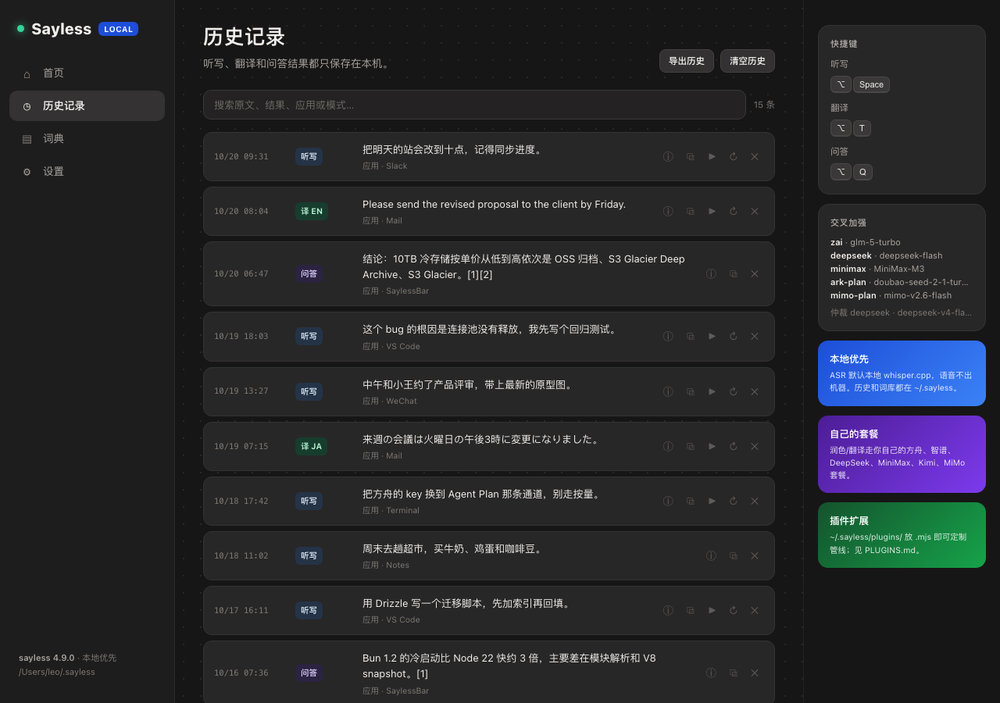
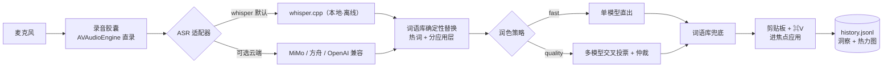
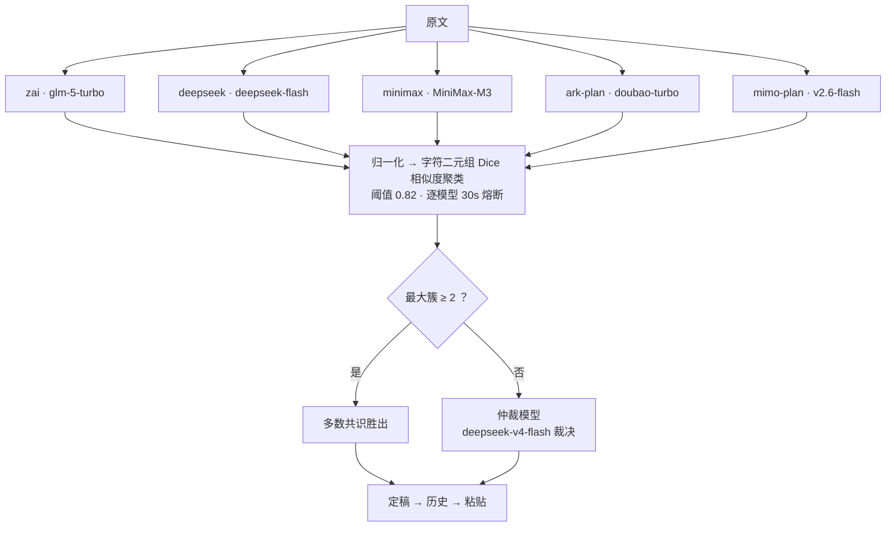
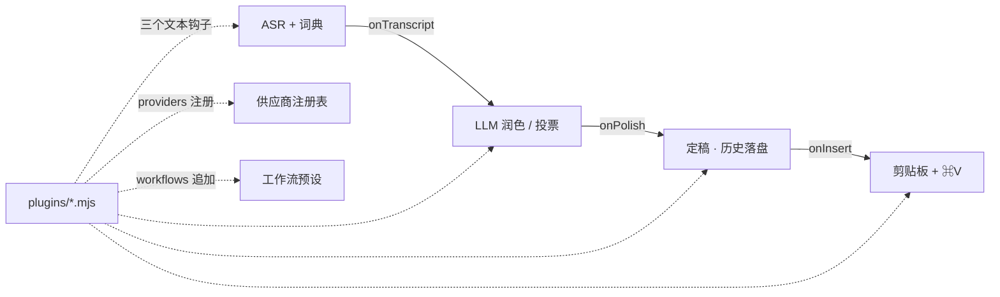

# Sayless

> ⚠️ **声明**：本项目是对 Typeless 应用进行**逆向工程的学习项目**，交互形态按 1:1 复刻仅作学习研究之用，**切勿用于任何商业用途**（详见 [LICENSE](LICENSE)）。与 Typeless 原开发者无任何隶属或授权关系。

**本地优先的中文语音听写 / 翻译 / 问答管线**——录音 → 语音识别 → 词语库 → 多模型润色 → 粘贴进焦点应用，配上一个 Typeless 风格的菜单栏 App。当前版本 **v4.9.0**（见 [CHANGELOG](CHANGELOG.md)）。

干净的自研实现（不含任何第三方听写应用代码），模型走**你自己的套餐**，词语库和听写历史全部本地。

```
麦克风 ──▶ ASR（本地 whisper.cpp / MiMo 云端）──▶ 词语库确定性替换
      ──▶ LLM 润色（单模型或 N 家交叉投票）──▶ 词语库兜底 ──▶ 剪贴板 + ⌘V
```

## 界面速览

<p align="center">
  <br/>
  <sub>录音胶囊：✕ 取消 · 实时波形 · ✓ 完成 —— Typeless 1:1 形态</sub>
</p>

| 首页：洞察 + 贡献热力图 | 历史：搜索 / 回放 / 重转写 / 删除 |
|---|---|
|  |  |
| **词典：替换 / 热词 / 风格规则 / 分应用词层** | **设置：ASR / 模型 / 交叉阵容 / Ask / 行为** |
|  |  |

<p align="center"></p>

## 特性一览

- **⌥Space 说话即打字**：菜单栏常驻，按住热键说话，松手文本自动润色并粘贴进当前焦点应用；⌥T 说话即翻译、⌥Q 说话即联网问答，键位可在设置页录制修改
- **本地优先**：ASR 默认本地 whisper.cpp（Metal 加速，8s 语音约 1s 转完），语音不出机器；配置、词库、历史、录音归档都是本机 0600
- **多模型交叉投票**：5 家模型并行出稿 → 字符二元组相似度聚类 → 多数共识取胜（取簇内 medoid），全分歧时仲裁模型裁决，实战全票率极高
- **个性化词语库**：专有名词保护、确定性替换、风格规则、按前台应用自动叠加分应用词层；hub 里可增删改
- **自我学习**：`sayless learn` 用 LCS 智能 diff 自动生成词条，`--mine --apply` 把高频修正回写词库
- **完全可定制**：`~/.sayless/plugins/` 放一个 `.mjs` 即可接管管线任意环节（见 [PLUGINS.md](PLUGINS.md)）
- **菜单栏面板（hub）**：数据驱动的四页 UI——洞察统计 + 贡献热力图 / 可搜索历史（复制、**▶ 回放**、**↻ 重转写**、删除、清空；界面最多加载最近 1000 条，统计按全部历史）/ 可视化词典（替换、热词、风格规则、分应用词层）/ 完整设置页（ASR、模型、交叉阵容、Ask、行为、快捷键录制、Key 写入、一键体检）
- **可靠性**：LLM 429/5xx 自动重试、录音结束才进入转写、配置原子写入、空识别非零退出、粘贴后恢复剪贴板（App 用 NSPasteboard 快照恢复文本/图片/文件；CLI 为文本级）；麦克风权限预检、UserNotifications 原生通知、词典/历史写入失败不再假成功



## 与 Typeless 对比

本项目是 Typeless 的**逆向学习项目**：通过对其 2.8.1 版本的行为观察与本机分析，学习一款成熟听写产品的交互设计与工程形态，并按 1:1 复刻交互（浮条与 hub），代码为**完全独立的干净实现**（不含其任何代码与资源）。逆向过程中沉淀的差异（对比基于 Typeless 2.8.1 公开行为与本机观察，2026-10）：

| 维度 | Typeless | Sayless |
|---|---|---|
| 定位 | 商业订阅产品 | 逆向学习项目（非商用，软件免费） |
| 模型费用 | 订阅费内含 | 走**你自己的套餐**（方舟 / 智谱 / DeepSeek / Kimi / MiMo…），花多少看得到 |
| 语音识别 | 云端 ASR，语音上传服务方 | 默认**本地 whisper.cpp 离线**，语音不出机器；可切 MiMo / 方舟云端 |
| 质量机制 | 单一管线 + 服务端质量网关 | 客户端 **5 家模型交叉投票 + 仲裁**，每条听写都是多数派共识 |
| 个性化 | 自定义词表 | 确定性替换 + 风格规则 + **按前台应用分层** + `learn` 自动学习闭环 |
| 扩展性 | 闭源，不可扩展 | **插件 API**：3 个管线钩子 + 自定义供应商 + 自定义工作流 |
| 数据归属 | 听写历史存于服务方 | 全部本地：历史 / 词库 / 反馈都在 `~/.sayless/`，随时导出删除 |
| 透明度 | 闭源 | 源码可审计；每个模型端点可 `sayless doctor` 实测连通与鉴权 |
| 交互形态 | 浮条 + hub 面板 | 同形态 1:1（✕/波形/✓ 胶囊、洞察 + 热力图 hub、四页导航） |
| 平台 | macOS | macOS，CLI 与菜单栏 App 可完全独立使用 |

一句话：**Typeless 卖的是省心，Sayless 给的是控制权**——模型、数据、词库、管线每一环都握在自己手里。再次强调：本项目仅作逆向学习之用，**切勿商用**。

## 快速开始

```sh
# 依赖：Node 18+，whisper.cpp（brew install whisper-cpp），ffmpeg（录音设备探测用）
git clone https://github.com/LeoLin990405/sayless.git && cd sayless
ln -sf "$PWD/sayless.mjs" /opt/homebrew/bin/sayless   # 终端调用更方便；App 构建时已自带 CLI

sayless init          # 生成 ~/.sayless/{config.json, dictionary.json}

# 下载 whisper 基座模型（148MB，必下；网络不畅可把域名换成 hf-mirror.com 镜像）
mkdir -p ~/.sayless && curl -L -o ~/.sayless/ggml-base.bin \
  https://huggingface.co/ggerganov/whisper.cpp/resolve/main/ggml-base.bin

sayless doctor        # 体检：ASR/链路/各家供应商 key/录音设备（模型缺失会标注）
sayless run           # 说话，回车停止 → 转写+润色+粘贴
```

菜单栏 App（可选但推荐）：

```sh
cd app && ./build.sh          # swiftc 编译 + 代码签名 + 安装 /Applications 并启动
BUILD_ONLY=1 ./build.sh       # 只打包到 app/SaylessBar.app，不安装（CI / 验证）
SAYLESS_SIGN=adhoc BUILD_ONLY=1 ./build.sh   # 跳过钥匙串里的持久证书，ad-hoc 签名（CI/无 GUI）
```

构建会把 `sayless.mjs` 与 `asr-ark-ws.mjs` 一起放进 `SaylessBar.app/Contents/Resources/`，因此 App 不依赖 `/opt/homebrew/bin/sayless` 也能跑；终端命令仍建议做上面的 symlink。

首次使用授权两次（都给 SaylessBar）：**麦克风**、**辅助功能**（热键与粘贴）。

## SaylessBar 菜单栏 App

- **录音胶囊**：屏幕底部浮出黑胶囊（✕ / 实时波形 / ✓），Thinking 态与结果预览自隐，Esc 取消，90s 自动收尾
- **hub 四页**：首页（口述字数/条数/活跃天/连续天 + 20 周热力图）｜历史记录（实时搜索、复制、回放、重转写、删除、清空）｜词典（替换/热词/词频/风格规则/分应用层增删改）｜设置（见下）
- **设置页**：ASR 引擎/路径/语种、润色供应商+模型+重试、翻译、交叉阵容与仲裁、Ask（引擎/代理/结果数）、工作流、提示音/PTT/结果投放/剪贴板恢复、**快捷键录制（冲突内联提示）**、**供应商 API Key 写入 + 各 provider 已配置状态**（密码框不回显，key 只落本地 config.json 0600）、**一键体检**——保存深合并写回 config.json，数字/空值也能正确清除
- **键位**：设置页点击键位后按下新组合，保存到 config.json 的 `"hotkeys"`（slot: dictate/translate/ask，key 为 macOS 键码，modifier: option/command/control/shift/none），重启 App 生效
- **菜单**：打开主面板 / 历史 / 设置 / 紧急停止录音 / 请求辅助功能授权 / 登录启动 / 词语库 / 数据目录 / 日志

构建与签名：

- `app/build.sh` 自动检测钥匙串里的 `Sayless Local Dev` 证书并以其签名——**TCC 授权（辅助功能/麦克风）跨重装永久保留**；找不到证书则回退 ad-hoc（每次重装需重开辅助功能开关）
- 构建产物自带 CLI（Resources/sayless.mjs），App 内转写、体检直接走 `node` 执行内置脚本；`SAYLESS_CLI` 可覆盖路径
- 制作持久证书（一次性，全自动）：`openssl req -x509 -newkey rsa:2048 -nodes -addext "extendedKeyUsage=codeSigning" -subj "/CN=Sayless Local Dev"` 生成 → `security import` → `security add-trusted-cert -p codeSign`（会弹一次 Touch ID/密码确认）
- 调试口子：`SAYLESS_SHOW_HUB=<0-3>` 启动即开对应页面（首页/历史/词典/设置）

## CLI 参考

| 命令 | 说明 |
|---|---|
| `sayless run` | 录音→转写→润色→粘贴。**等录音真正结束后才进入转写**；`--sec N` 定长，`--raw` 跳过 LLM，`--no-insert` 只输出，`--translate en` 翻译模式，`--ask` 问答模式，`--workflow quality` 临时切工作流 |
| `sayless rec --sec 5 -o a.wav` | 仅录音（16k mono wav，0600）；可用 `SAYLESS_FFMPEG` / `rec.device` 指定 |
| `sayless asr <file.wav>` | 仅转写（走当前 ASR 适配器，可选 `--app` 词层） |
| `sayless polish "<text>"` | 只润色。`--dry-run` 只过词语库，`--cross` 强制投票；文本传 `-` 从 stdin 读 |
| `sayless translate "<text>" --to ja` | 翻译，10 语种；`--say` 先录音 |
| `sayless ask "<问题>"` | Bing CN + DuckDuckGo 检索 → 带 [n] 引用的回答；`--say` 先录音，`--no-search` 跳过联网 |
| `sayless transcribe <wav>` | 转写→润色→粘贴，App 外壳复用此命令；`--force` 绕过短语音守卫 |
| `sayless insert "<text>"` | 手动粘贴任意文本进焦点应用（默认 1.6s 后恢复剪贴板） |
| `sayless dict add\|del\|add-hot\|del-hot\|import\|stats\|export\|validate` | 词语库管理；`import` 支持每行 `a=>b`、纯热词，或 `dict export` 产出的 JSON（自动合并）；`app-add-hot` / `app-add-replace` 管理分应用词层 |
| `sayless learn "<原文>" "<改稿>"` | LCS 智能 diff 自动生成替换规则；`--last` 对比上一条；`--mine [--apply]` 挖掘并回写高频修正；`--dry-run` 不落盘 |
| `sayless history [-n 20] [--json] [--search q] [--delete n\|ts] [--clear --force] [--export file]` | 历史查看、搜索、删除、清空、导出 |
| `sayless stats [--json]` | 口述字数/条数/活跃天/连续天/模式与 app 分布/录音归档大小 |
| `sayless plugin` | 已加载插件及钩子 |
| `sayless doctor [--offline] [--json]` | 体检：ASR/Node/ffmpeg/权限/供应商实测/录音设备；`--offline` 不联网 |
| `sayless devices` | 列出 avfoundation 录音设备（只取音频段） |

通用旗标：`--provider <id>`、`--model <id>` 单次切换供应商与模型；`--cross` 强制交叉投票；`--workflow <id>` **显式**应用整套预设；`--json`、`--force`、`--no-insert`、`--app <name>`。以 `-` 开头的文本用 `--` 分隔（如 `sayless polish -- "-dash-text"`）。

环境变量：`SAYLESS_DIR` 覆盖数据目录（测试/多套配置），`SAYLESS_API_KEY` 作为**未配置 provider key 时的兜底**（显式配置优先），`SAYLESS_FFMPEG` / `SAYLESS_AUDIO_DEVICE` 指定录音命令与设备。

## 多模型

`config.json → providers` 注册任意 OpenAI 兼容供应商（baseUrl + apiKey），内置预设：

| 供应商 | 端点 | 备注 |
|---|---|---|
| `ark-plan` | `ark.cn-beijing.volces.com/api/plan/v3` | 火山方舟 Agent Plan 套餐（豆包系列） |
| `deepseek` | `api.deepseek.com/v1` | |
| `zai` | `open.bigmodel.cn/api/coding/paas/v4` | 智谱 GLM Coding Plan |
| `minimax` | `api.minimaxi.com/v1` | 走非标路径 `chatPath=/text/chatcompletion_v2`（provider 配置支持） |
| `kimi` | `api.kimi.com/coding/v1` | Kimi for Coding（`sk-kimi-` key 专用端点） |
| `qwen-plan` | `token-plan.cn-beijing.maas.aliyuncs.com/compatible-mode/v1` | 阿里 Token Plan（`sk-sp-` key 只认自家 maas 网关） |
| `bailian-ws` | workspace 专属网关 | 百炼工作区，需控制台开通模型 |
| `stepfun` / `stepfun-plan` | `api.stepfun.com/v1` / `/step_plan/v1` | **套餐额度走 `/step_plan` 专用地址**，与按量余额独立；需[实名认证](https://account.stepfun.com/security?action=realname)；仅 `step-router-v1`（输出带脚手架，勿入投票） |
| `mimo` / `mimo-plan` | `api.xiaomimimo.com/v1` / `token-plan-sgp.xiaomimimo.com/v1` | 小米 Token Plan 的 `tp-` key 走专属域名；V2.5 系 chat 模型已下线，用 `mimo-v2.6-flash` |
| `dashscope` / `siliconflow` / `moonshot` / `zhipu` | — | 预设就绪，填 key 即用 |

经验法则：**同一家的"套餐"和"按量"往往是两套额度、两个地址**——402/403 先查是不是打错了通道（`sayless doctor` 一目了然）。

### 交叉投票（`--cross`）



`cross.models` 里每家并行出稿（逐模型 30s 熔断）→ 归一化字符二元组 Dice 相似度聚类（阈值 `similarity: 0.82`）→ 最大簇 ≥2 即共识，全分歧时 `cross.arbiter` 裁决。当前阵容：zai + deepseek + minimax + ark-plan + mimo-plan 五家，实测常全票。

### 工作流

`workflows` 预设可以组合 ASR / 模型 / 投票策略，`activeWorkflow` 为默认：

- `fast` — 单模型直出（日常听写推荐，2-3s）
- `quality` — 交叉投票（~15s）
- `cloud` — 云端 ASR + 投票

**重要：持久 `activeWorkflow` 只决定“是否投票”这类策略，不会覆盖设置页里选的 ASR 引擎与模型；只有显式 `--workflow <id>` 才临时应用整套预设（包括 `cloud` 的云端 ASR）。** 这样设置页的 ASR / provider / model 选择始终生效，不会被旧工作流静默改回去。

## 个性化词语库（dictionary.json）

```jsonc
{
  "replacements": [{ "from": "摆链", "to": "Bailian" }],   // 确定性替换，LLM 前后各跑一遍，离线也生效
  "hotwords": ["ZCode", "Bailian"],                        // 专有名词注入 prompt，防 ASR/LLM 瞎改
  "styleRules": ["删除语气词", "技术名词保留英文"],           // 逐条进润色 system prompt
  "apps": { "微信": { "hotwords": ["方舟"] } }              // 按前台应用自动叠加词层
}
```

`sayless learn` 学习闭环：LCS 智能 diff（中文按 Intl.Segmenter 分词）对比原文与改稿生成替换规则 → 写入 `feedback.jsonl` → `--mine` 挖掘高频模式 → `--mine --apply --min-count 2` 自动回写 → hub 词典页可视化管理。

## 插件（开发口子）

不改源码定制管线：`~/.sayless/plugins/*.mjs` 自动加载，可导出 `onTranscript / onPolish / onInsert` 文本钩子、`providers` 自定义供应商、`workflows` 工作流预设。按应用切语气、行业术语后处理、听写同步外部系统等食谱见 **[PLUGINS.md](PLUGINS.md)**，`sayless plugin` 查看加载状态。



## ASR 引擎

| adapter | 说明 |
|---|---|
| `whisper`（默认） | 本地 whisper.cpp + ggml 模型，离线、零成本；静音幻觉（括号包裹输出）自动过滤 |
| `mimo-asr` | MiMo-V2.5-ASR 云端：中英双语+方言+自动标点，走 Token Plan 套餐按秒计费；chat 接口 + input_audio base64，地址/key 自动取 `providers.mimo-plan` |
| `ark-ws` | 火山方舟语音大模型流式识别（需在方舟控制台开 Agent Plan 按量扣费） |
| `openai` | 任意 OpenAI 兼容 `/audio/transcriptions` 端点 |

## 配置参考（~/.sayless/config.json，0600）

```jsonc
{
  "providers": { "<id>": { "baseUrl": "...", "apiKey": "...", "model": "...", "chatPath": "..." } },
  "asr":     { "adapter": "whisper", "whisperBin": "/opt/homebrew/bin/whisper-cli",
               "whisperModel": "~/.sayless/ggml-base.bin", "language": "zh",
               "filterHallucinations": true },
  "llm":       { "provider": "ark-plan", "model": "doubao-seed-2-1-turbo-260628",
                 "temperature": 0, "retries": 2, "timeoutMs": 45000 },
  "translate": { "to": "en", "provider": "ark-plan", "model": "..." },
  "ask":       { "provider": "ark-plan", "model": "...", "engines": ["bing", "ddg"],
                 "maxResults": 5, "proxy": "http://127.0.0.1:7897" },
  "cross":     { "models": [{ "provider": "...", "model": "..." }],
                 "arbiter": { "provider": "deepseek", "model": "..." },
                 "similarity": 0.82, "timeoutMs": 30000 },
  "rec":       { "ffmpeg": "", "device": ":0" },  // 录音命令与 avfoundation 设备
  "recordings":{ "keep": 200 },                   // 归档保留条数
  "insert":    { "mode": "paste", "restoreClipboard": true }, // paste | none
  "sound": true, "ptt": false,                   // ptt 需辅助功能授权
  "hotkeys":   { "dictate": { "key": 49, "modifier": "option", "label": "Space" },
                 "translate": { "key": 17, "modifier": "option", "label": "T" },
                 "ask": { "key": 12, "modifier": "option", "label": "Q" } },
  "workflows": { "fast": {}, "quality": { "cross": true }, "cloud": { "cross": true } },
  "activeWorkflow": "fast"
}
```

文件布局：`~/.sayless/` 下 `config.json`（0600，含 key，不入库）、`dictionary.json`（0600）、`history.jsonl`（0600）、`feedback.jsonl`（0600）、`recordings/`（音频归档 0600，自动保留最近 200 条，hub 历史页可回放/重转写）、`last-utterance.wav`（0600，.gitignore 排除）、`plugins/`、`ggml-base.bin`。

数据目录默认 `~/.sayless`，可用 `SAYLESS_DIR=/path` 覆盖（测试、多套配置、外置磁盘均适用）。`history.jsonl` 为控制文件大小，`out` 最多存 1000 字、`raw` 500 字；条目另有完整 `chars` / `rawChars` 计数，`stats` 与 hub 统计不受截断影响。

## 开发与测试

```sh
npm test                     # 71 个 Node 集成测试：CLI 管线 / 交叉投票 / 重试 / 词典 / learn / history / hub
npm run check                # node --check + 完整测试
BUILD_ONLY=1 ./app/build.sh  # 只编译打包 App（不装 /Applications、不启动）
node tools/gen-hub-demo.mjs /tmp/hub-demo  # Chrome headless 渲染 hub 四页截图 + DOM js-error 检查
```

测试不访问真实模型：`test/helpers.mjs` 起本地 mock 供应商/ASR 服务，并用假 ffmpeg 写入 WAV，因此 `run` 的录音等待、重试、交叉投票、历史落盘都能端到端验证。App 另有 headless 调试口子：

```sh
CFFIXED_USER_HOME=/tmp/fakehome SAYLESS_DUMP_HUB=/tmp/hub.html SAYLESS_DUMP_HUB_TAB=3 \
  ./app/SaylessBar.app/Contents/MacOS/SaylessBar
```

## 故障排查

| 症状 | 原因与解法 |
|---|---|
| 粘贴报错 1002 / 粘贴无效 | 辅助功能授权掉了（ad-hoc 签名重装必掉）→ 重新开关一次；换持久证书后永久解决（见上） |
| `no speech, peak=0.0` | 麦克风没采到声：确认 SaylessBar 持有麦克风权限、**只运行了一个实例**（两个实例会互抢输入）、说话音量正常 |
| key 鉴权 402/403 | 套餐与按量通道打错：StepFun 要打 `/step_plan/v1` 且先实名；`sk-sp-`/`sk-kimi-`/`tp-` 各自只认自家专属域名；`sayless doctor` 分组实测 |
| 菜单栏 App 热键无反应 | 辅助功能未授权（tap 未启用走 Carbon 兜底）→ 菜单"请求辅助功能授权…"或系统设置重开 |
| hub 打不开/渲染异常 | 看日志 `~/.sayless/saylessbar.log`；模板在 `app/hub.html`，重新 `build.sh`；也可用上面的 `SAYLESS_DUMP_HUB` 导出 HTML 检查 |
| 设置页改了 ASR / 模型却不生效 | v4.5 起顶层 `asr` / `llm` / `translate` / `ask` 优先；持久 `activeWorkflow` 只影响投票策略。若手动用 `--workflow`，会临时应用整套预设 |
| App 报“找不到 sayless CLI” | 重新 `app/build.sh`（会内置 CLI），或 `ln -sf "$PWD/sayless.mjs" /opt/homebrew/bin/sayless`；也可用 `SAYLESS_CLI` 指定 |
| hub 输入框打不了字 / 搜索没反应 | v4.5 已改为普通可聚焦窗口并修复历史搜索 class；确认运行的是新构建的 App |
| `sayless run` 还没说完就开始转写 | v4.5 已修复：`rec` 改为 Promise，等 ffmpeg 真正退出后才进入 ASR |

## 隐私

语音默认只发给**你自己配置的本地 whisper**，不出机器；切云端 ASR/换模型时，数据只流向你亲自填入 key 的那些端点。听写历史、词语库、录音归档、插件全在本地 `~/.sayless/`，权限收紧到 0600；hub 读配置时会把 `apiKey` 全部剥掉，只给前端 `hasKey` 布尔值。

## License

**非商用学习项目**：仅供个人学习、研究与交流，严禁任何形式的商业使用（出售 / 付费分发 / SaaS / 闭源二次发行 / 并入商业产品）。详见 [LICENSE](LICENSE)。

变更记录见 [CHANGELOG.md](CHANGELOG.md)。
