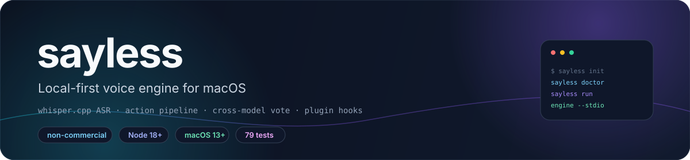
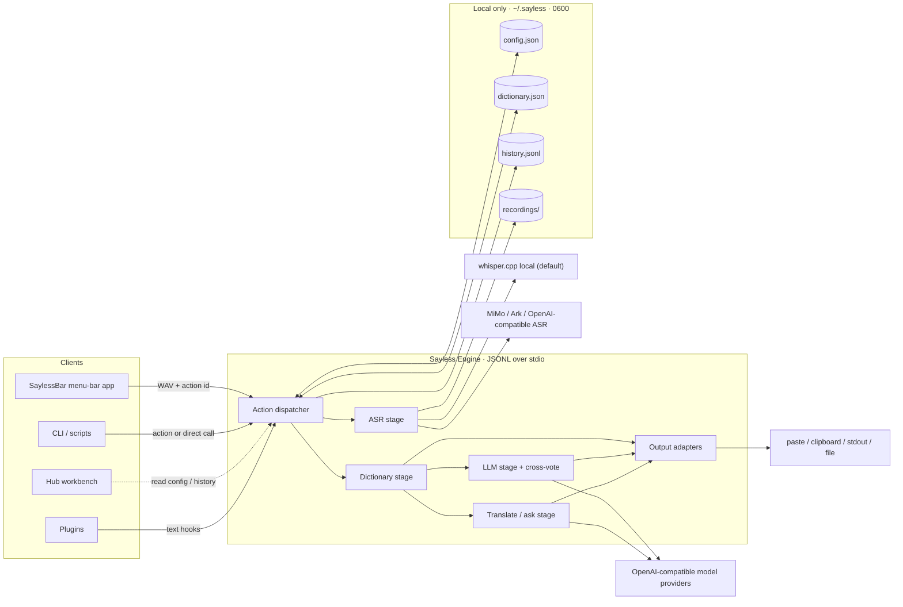
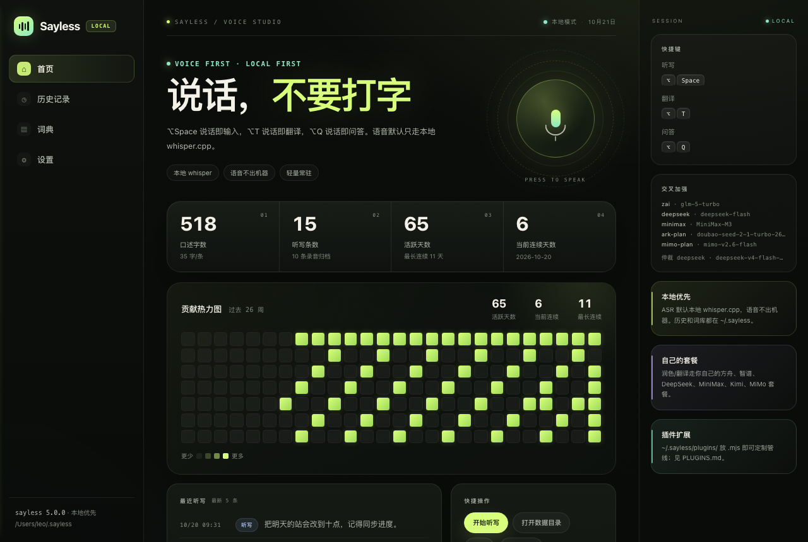
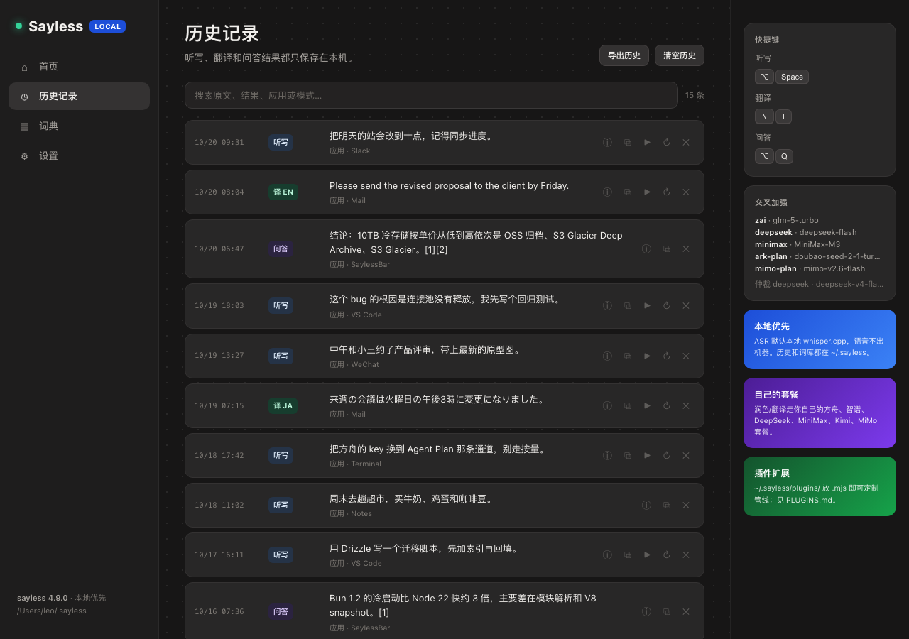
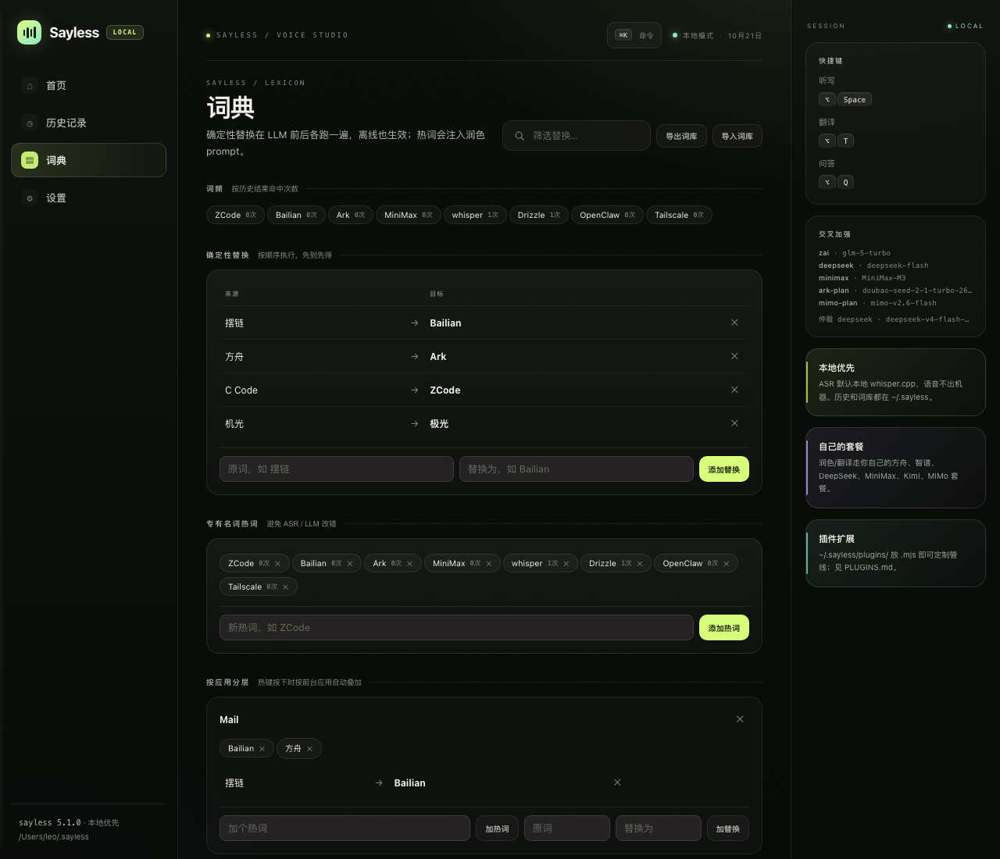
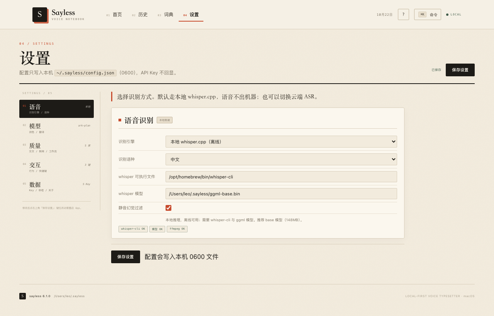
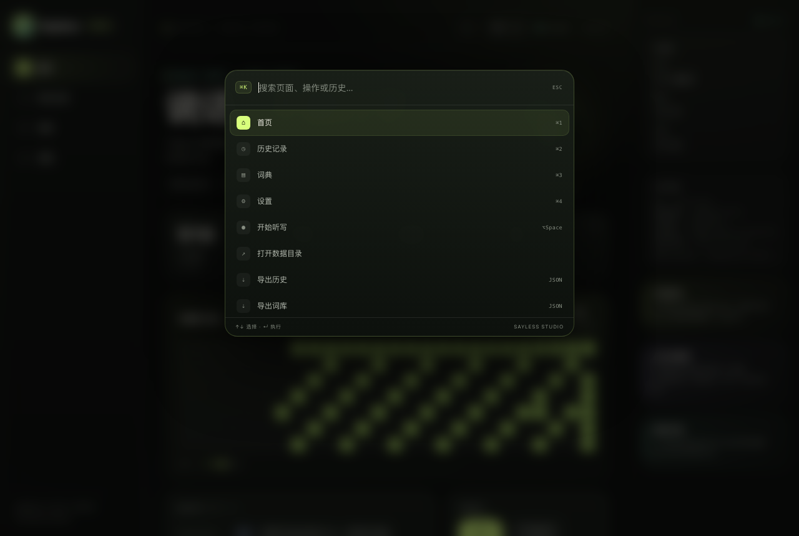
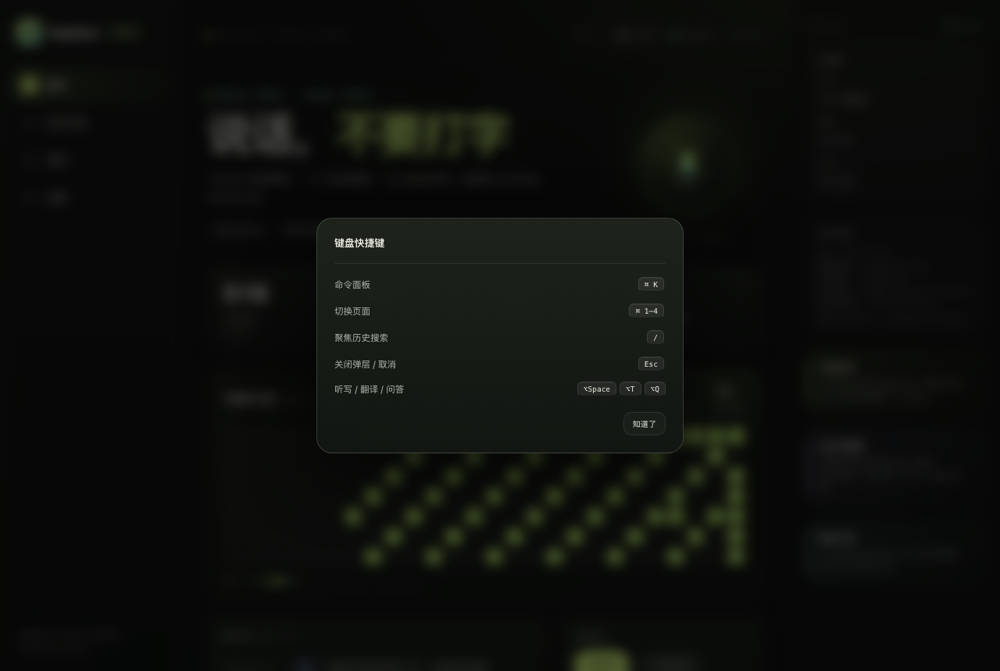
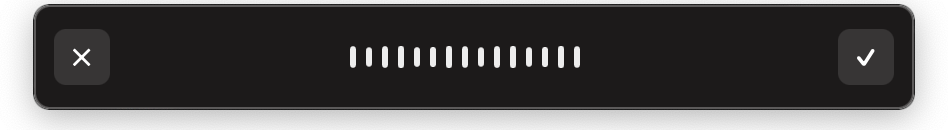
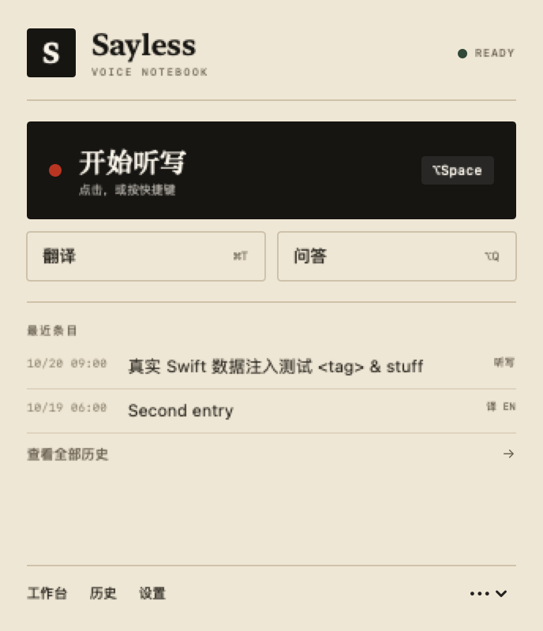

<div align="center">



# Sayless

**Local-first voice engine for macOS: dictate, translate, ask, and compose your own speech actions.**

Local whisper.cpp ASR · programmable action pipeline · multi-model cross-vote · plugin hooks · data stays on the machine.

[**简体中文**](README.zh-CN.md) · **English**

<a href="LICENSE"></a>
<a href="package.json"></a>
<a href="app/"></a>
<a href="test/"></a>
<a href=".github/workflows/ci.yml"></a>

</div>

> [!NOTE]
> **Current state.** Sayless v7.0.0 is an independent, local-first voice engine. The core is a
> long-lived **Sayless Engine** with a programmable **Action / Pipeline** protocol; the menu-bar app,
> CLI, hub workbench, and plugins are clients of that engine. The project is for personal study and
> research only — commercial use is not permitted (see [LICENSE](LICENSE)).

## ✨ Features

- **Hold a hotkey, get text.** `⌥Space` dictates into the focused app; `⌥T` translates, `⌥Q` answers
  a spoken question with web search. All three hotkeys are re-recordable in settings.
- **Programmable engine.** `sayless engine --stdio` is a long-lived process speaking JSON Lines;
  an action is an ordered list of stages (`asr → dict → llm → translate → ask`) with an output
  adapter (`paste / clipboard / stdout / file / none`). New actions are added in `config.json`, no code change.
- **Local by default.** ASR defaults to local whisper.cpp with Metal acceleration; audio never
  leaves the machine unless you configure a cloud ASR adapter. Engine, dictionary, history, and
  recordings live under `~/.sayless` with `0600` permissions.
- **Cross-model voting.** Up to five providers draft in parallel; drafts are clustered by character
  bigram Dice similarity (threshold `0.82`) and the majority cluster wins, with an arbiter model
  deciding when nothing agrees.
- **Personal dictionary.** Deterministic replacements, hotwords, style rules, and per-application
  layers, all editable from the hub and applied before and after the LLM stage.
- **Learning loop.** `sayless learn` diffs your original vs. corrected text with LCS, writes
  replacement rules, and `--mine --apply` writes high-frequency corrections back to the dictionary.
- **Plugin hooks.** Drop a `.mjs` file into `~/.sayless/plugins/` to override `onTranscript`,
  `onPolish`, `onInsert`, or register providers and workflows — see [PLUGINS.md](PLUGINS.md).
- **Sayless Paper UI.** A paper-toned menu-bar shell and hub: masthead navigation, seal, 52-week
  writing record, paper ledger history, `⌘K` command palette, and `⌘1–4` tab switching.
- **Broad model access.** 14 built-in OpenAI-compatible provider presets and a provider editor for
  any OpenAI-compatible endpoint; model names are free-form and can differ per task.
- **Permission assistant.** Separates Accessibility (control/paste) from Input Monitoring (global
  hotkeys), re-registers the app on updates, and reports actionable state in the menu and hub.

## 🧠 Architecture



The implementation is flat by design: [`sayless.mjs`](sayless.mjs) bundles engine, CLI, ASR adapters,
dictionary, history, providers, and plugins; [`asr-ark-ws.mjs`](asr-ark-ws.mjs) is the Ark streaming
ASR adapter; [`app/`](app/) holds the SwiftUI/AppKit menu-bar app and hub HTML; [`test/`](test/)
contains the Node integration suite; [`tools/`](tools/) has demo/rendering helpers. Process topology,
stage semantics, the JSONL protocol, and extension points are documented in
[ARCHITECTURE.md](ARCHITECTURE.md).

## 🚀 Quick start

**Requirements:** macOS 13+, Node 18+, [`whisper.cpp`](https://github.com/ggerganov/whisper.cpp)
(`brew install whisper-cpp`), and `ffmpeg` (device detection and recording).

```sh
git clone https://github.com/LeoLin990405/sayless.git
cd sayless
ln -sf "$PWD/sayless.mjs" /opt/homebrew/bin/sayless   # optional, for terminal use

sayless init          # creates ~/.sayless/{config.json, dictionary.json}

mkdir -p ~/.sayless && curl -L -o ~/.sayless/ggml-base.bin \
  https://huggingface.co/ggerganov/whisper.cpp/resolve/main/ggml-base.bin

sayless doctor        # checks ASR, providers, and recording devices
sayless run           # speak, press Enter to stop → transcribe → polish → paste
```

The menu-bar app is optional but recommended:

```sh
cd app && ./build.sh            # build, sign, install to /Applications, launch
BUILD_ONLY=1 ./build.sh         # package to app/SaylessBar.app only (CI / verification)
SAYLESS_SIGN=adhoc BUILD_ONLY=1 ./build.sh   # ad-hoc signing, no Keychain certificate
```

> [!TIP]
> The first launch asks for two permissions, both granted to `SaylessBar`: **Microphone** and
> **Accessibility** (hotkeys and paste). The build embeds `sayless.mjs` and `asr-ark-ws.mjs` in the
> app bundle, so the app works even without the `/opt/homebrew/bin/sayless` symlink.

## 🖥️ SaylessBar app & hub

| Home: masthead, seal, 52-week writing record | History: paper ledger, search, replay, re-transcribe |
|---|---|
|  |  |
| **Dictionary: index, replacements, hotwords, per-app layers** | **Settings: category navigation, one form group, save state** |
|  |  |
| **⌘K command palette** | **? shortcut help** |
|  |  |

<p align="center">
  <br/>
  <sub>Recording capsule: vermilion dot · ink waveform · red stop</sub>
</p>
<p align="center">
  <br/>
  <sub>Menu-bar panel: recent entries, three built-in actions, quick links</sub>
</p>

## 🗂️ CLI & actions

The most-used commands; the full table (history, dictionary, learn, plugins, devices, environment
variables) is in [`docs/reference.md`](docs/reference.md).

| Command | What it does |
|---|---|
| `sayless run` | Record → transcribe → polish → paste. `--sec N`, `--raw`, `--no-insert`, `--translate en`, `--ask`, `--workflow quality` |
| `sayless rec --sec 5 -o a.wav` | Record only (16 kHz mono WAV, `0600`); `SAYLESS_FFMPEG` / `rec.device` select the recorder |
| `sayless asr <file.wav>` | Transcribe only through the configured ASR adapter; `--app` selects an app dictionary layer |
| `sayless polish "<text>"` | Polish only; `--dry-run` for dictionary-only, `--cross` to force voting, `-` reads stdin |
| `sayless translate "<text>" --to ja` | Translate into one of 10 languages; `--say` records first |
| `sayless ask "<question>"` | Search (Bing CN + DuckDuckGo) → answer with `[n]` citations; `--no-search` skips the web |
| `sayless engine --stdio` | Long-lived engine for clients; JSONL on stdin/stdout |
| `sayless actions` / `sayless action <id> [wav]` | List actions or execute one directly |
| `sayless doctor` | Health check: ASR, Node, ffmpeg, permissions, providers, devices (`--offline`, `--json`) |

Actions are configured in `~/.sayless/config.json`:

```jsonc
"actions": {
  "dictate":   { "label": "Dictate",   "pipeline": ["asr","dict","llm","dict"],       "output": "paste" },
  "translate": { "label": "Translate", "pipeline": ["asr","dict","translate","dict"], "output": "paste" },
  "ask":       { "label": "Ask",       "pipeline": ["asr","dict","ask","dict"],       "output": "paste" },
  "note":      { "label": "Voice note","pipeline": ["asr","dict","llm"],              "output": "file",
                 "file": "~/Notes/voice.md" }
}
```

## 🧩 Models, dictionary & plugins

**Providers.** `config.json → providers` registers any OpenAI-compatible endpoint. Presets include
Ark Agent Plan (`ark-plan`), DeepSeek (`deepseek`), Z.ai GLM (`zai`), MiniMax (`minimax`), Kimi
(`kimi`), Qwen Token Plan (`qwen-plan`), StepFun (`stepfun`), MiMo (`mimo`), and generic
`dashscope` / `siliconflow` / `moonshot` / `zhipu` entries. A vendor's subscription plan and
pay-as-you-go quota are usually different endpoints — check with `sayless doctor` when you see
402/403. Full provider matrix and quota notes: [`docs/reference.md`](docs/reference.md).

**Cross-vote.** `--cross` (or the `quality` workflow) runs the configured models in parallel, then
normalises and clusters drafts with Dice similarity; the largest cluster of at least two wins, and
the arbiter model decides full disagreements. Each model call has a 30 s timeout.

**Dictionary.** `dictionary.json` holds `replacements`, `hotwords`, `styleRules`, and per-app
layers. Replacements run before and after the LLM, so they also work offline. `sayless learn`
generates candidate rules from edits; the hub manages them visually.

**Plugins.** `~/.sayless/plugins/*.mjs` are loaded automatically and may export text hooks
(`onTranscript`, `onPolish`, `onInsert`), custom providers, and workflow presets. Recipes and the
module contract are in [PLUGINS.md](PLUGINS.md).

## 📦 Local data & privacy

All state lives under `~/.sayless` (override with `SAYLESS_DIR`), created with `0600` permissions:

| Path | Contents |
|---|---|
| `config.json` | Providers, ASR/LLM settings, actions, hotkeys — contains API keys, never committed |
| `dictionary.json` | Replacements, hotwords, style rules, per-app layers |
| `history.jsonl` | Dictation history; `out` capped at 1,000 chars, `raw` at 500 |
| `feedback.jsonl` | Learning-loop corrections from `sayless learn` |
| `recordings/` | Audio archive, last 200 kept, replayable from the hub |
| `plugins/` | User plugins |

The hub strips every `apiKey` before rendering and only sees a `hasKey` boolean. Audio is sent only
to the ASR endpoint you configured; with the default whisper.cpp adapter it never leaves the machine.

## 📁 Repository layout

| Path | Contents |
|---|---|
| `sayless.mjs` | Engine, CLI, ASR adapters, dictionary, history, providers, plugin loader |
| `asr-ark-ws.mjs` | Ark streaming ASR adapter |
| `app/` | Menu-bar app: Swift sources, `build.sh`, hub HTML, `Info.plist` |
| `test/` | Node integration suite with mock providers, mock ASR, and a fake ffmpeg |
| `tools/` | Demo and headless rendering helpers |
| `docs/` | Architecture details, memory-integration proposal, screenshots, this reference |
| `examples/` | Example plugins |
| `.github/workflows/ci.yml` | macOS CI: syntax check, tests, app build, headless UI smoke test |

## 🛠️ Development

```sh
npm test                     # 79 Node integration tests: CLI, pipeline, cross-vote, dictionary, history, hub
npm run check                # node --check + full test suite
BUILD_ONLY=1 ./app/build.sh  # compile the app without installing it
node tools/gen-hub-demo.mjs /tmp/hub-demo   # render hub screenshots + DOM js-error check
```

Tests never call real models: `test/helpers.mjs` starts local mock provider and ASR servers and a
fake ffmpeg writes WAV files, so recording waits, retries, cross-vote, and history persistence are
covered end to end. CI runs the same commands on `macos-14` with Node 20.

## 🧭 Scope, limits & roadmap

- **Platform.** The app is macOS-only (13+); the CLI depends on macOS audio APIs for recording.
- **Not a product.** This is a personal, non-commercial project: no hosted service, no support SLA.
- **ASR scope.** whisper.cpp (local), MiMo ASR, Ark streaming, and any OpenAI-compatible
  `/audio/transcriptions` endpoint. Native Anthropic/Gemini protocols are not built in; use a
  gateway or a plugin.
- **Permissions.** macOS never grants Accessibility or Microphone automatically; after binary
  updates TCC may reset and require re-toggling.
- **Dictionary quality.** Replacement rules are deterministic; a bad rule can corrupt output, so
  review `sayless learn` proposals before applying them.

Roadmap:

- [ ] Add more ASR adapters and a documented adapter contract
- [ ] Expand the hub's history analytics without changing the local-first data model
- [ ] Publish more plugin recipes (per-app tone, domain terminology, external sync)
- [ ] Improve cross-vote cost controls and per-provider timeouts

## 🤝 Contributing

Issues and pull requests are welcome. Before opening a PR:

1. run `npm test` and `npm run check`;
2. keep the non-commercial licensing terms intact;
3. never commit API keys, `~/.sayless` data, recordings, or personal dictionaries;
4. if you change the engine protocol, update [ARCHITECTURE.md](ARCHITECTURE.md) and the reference doc.

If Sayless is useful to you, consider leaving a ⭐.

## 📄 License & attribution

Sayless is released under a **custom non-commercial license**: personal study, research, and
non-commercial sharing are allowed with the notice preserved; selling, paid distribution, SaaS,
closed-source redistribution, and inclusion in commercial products are prohibited. Read the exact
terms in [LICENSE](LICENSE). This project contains no code, assets, or data from third-party
dictation apps and is not affiliated with the original Typeless developers.

Model files downloaded for whisper.cpp follow their own licenses; provider endpoints are governed by
each vendor's terms. The changelog is in [CHANGELOG.md](CHANGELOG.md), and a proposed long-term
memory integration is described in [docs/MEMORY_INTEGRATION.md](docs/MEMORY_INTEGRATION.md).

## ⭐ Star history

<div align="center">

<a href="https://star-history.com/#LeoLin990405/sayless&Date">
  
</a>

</div>
