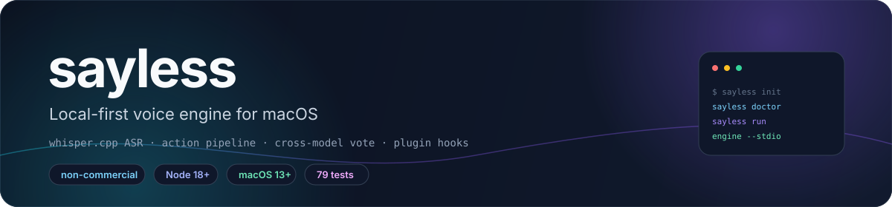
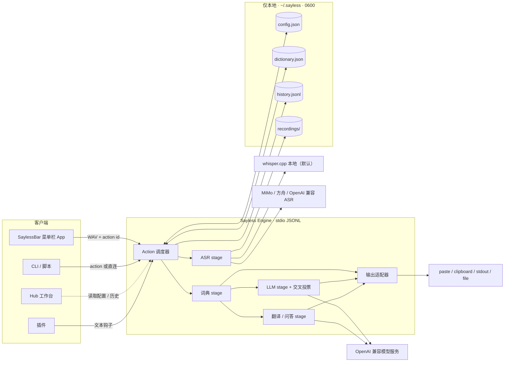
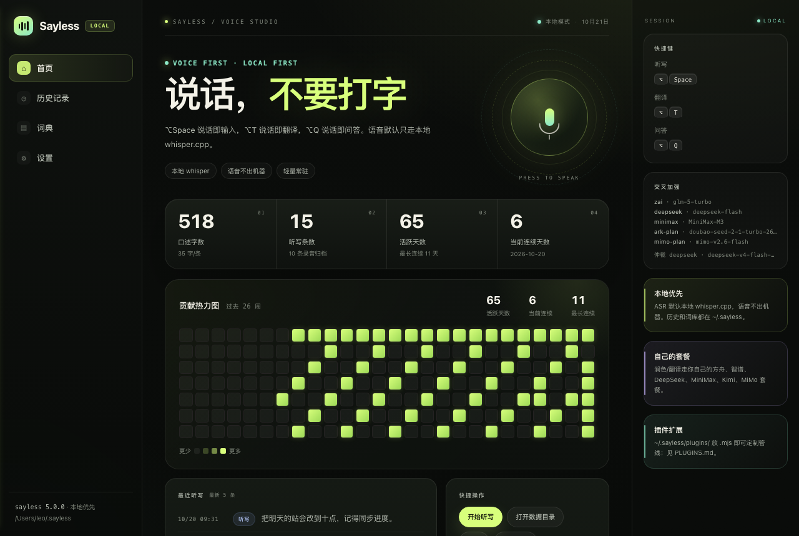
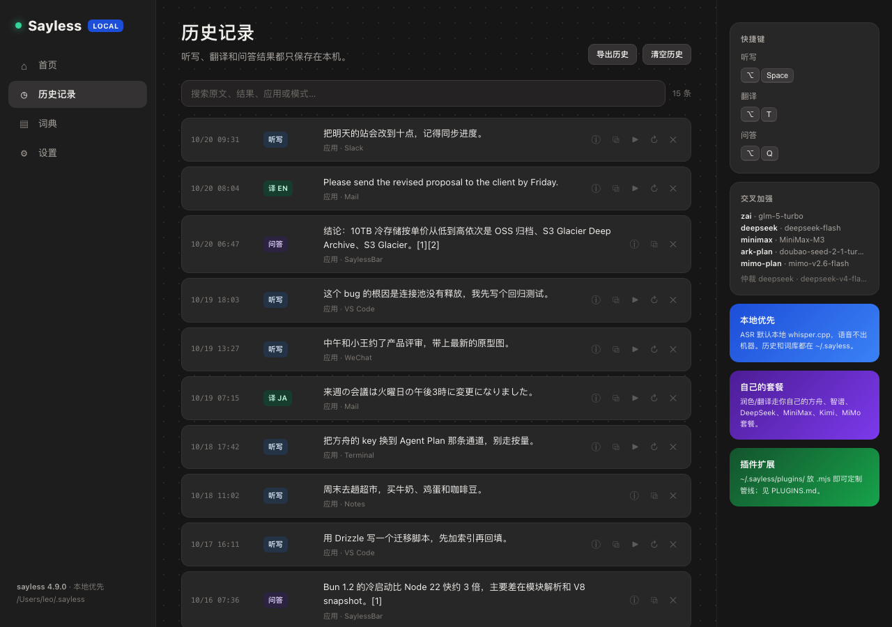
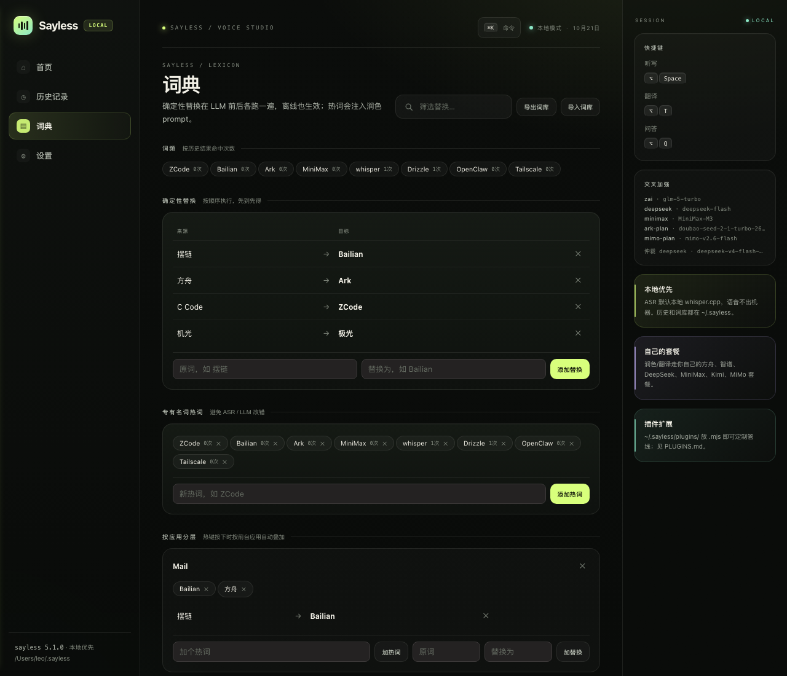
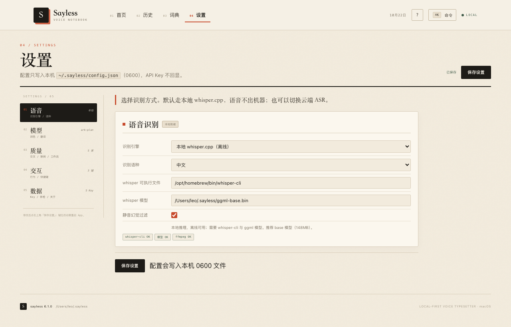
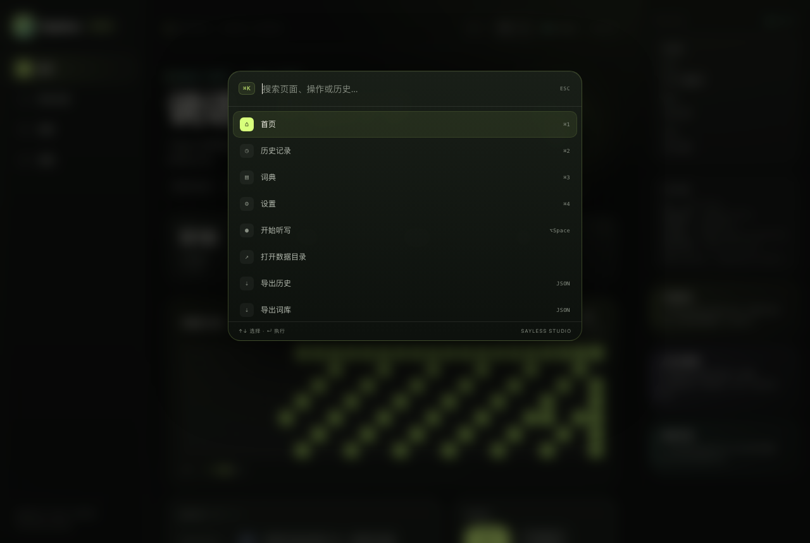
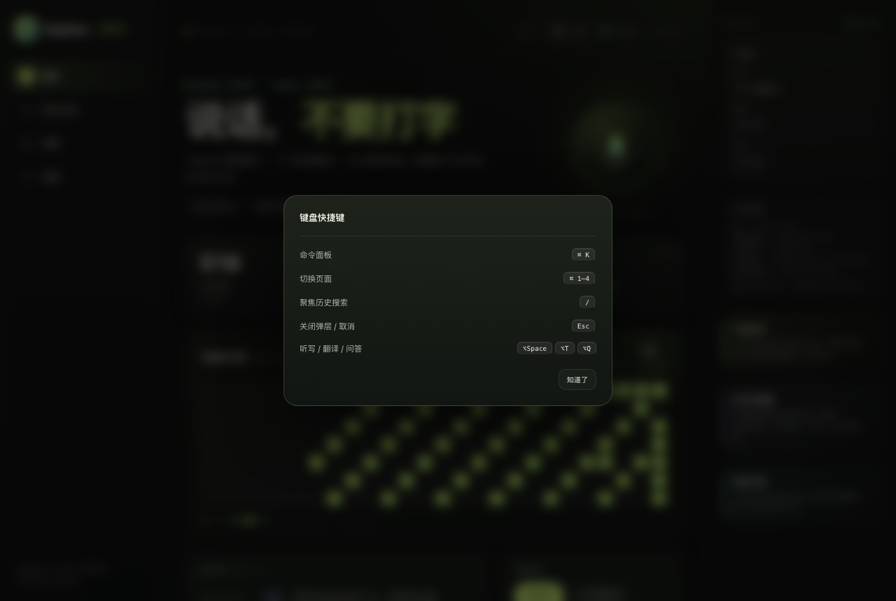
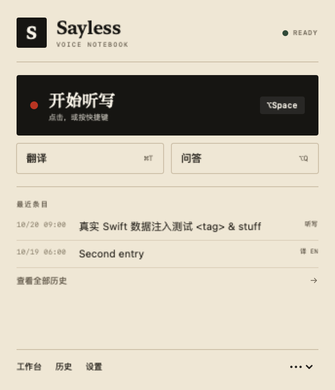

<div align="center">



# Sayless

**macOS 上的本地优先语音引擎：听写、翻译、问答，以及自由组合的语音动作。**

本地 whisper.cpp ASR · 可编程 action pipeline · 多模型交叉投票 · 插件钩子 · 数据留在本机。

**简体中文** · [**English**](README.md)

<a href="LICENSE"></a>
<a href="package.json"></a>
<a href="app/"></a>
<a href="test/"></a>
<a href=".github/workflows/ci.yml"></a>

</div>

> [!NOTE]
> **当前状态。** Sayless v7.0.0 是一个独立实现的本地优先语音引擎。核心是长驻的 **Sayless Engine**
> 与可编程的 **Action / Pipeline** 协议；菜单栏 App、CLI、hub 工作台与插件都是它的客户端。
> 本项目仅供个人学习研究，**禁止商用**（见 [LICENSE](LICENSE)）。

## ✨ 特性

- **按住热键就能说话。** `⌥Space` 把语音听写进当前焦点应用；`⌥T` 翻译、`⌥Q` 用语音提问并联网检索作答。
  三个热键都能在设置页重新录制。
- **可编程引擎。** `sayless engine --stdio` 是长驻进程，走 JSON Lines 协议；一个 action 就是有序的
  stage 列表（`asr → dict → llm → translate → ask`）加一个输出适配器
  （`paste / clipboard / stdout / file / none`）。新增 action 只改 `config.json`，不用改代码。
- **默认本地。** ASR 默认用本地 whisper.cpp（Metal 加速），不配置云端适配器时语音不出机器；
  引擎、词典、历史与录音都放在 `~/.sayless`，权限 `0600`。
- **多模型交叉投票。** 最多 5 家 provider 并行出稿，按字符二元组 Dice 相似度聚类（阈值 `0.82`），
  取多数簇；全部分歧时由仲裁模型裁决。
- **个性化词典。** 确定性替换、热词、风格规则、按前台应用叠加的词层，都能在 hub 里管理，
  并在 LLM 前后各应用一次。
- **学习闭环。** `sayless learn` 用 LCS 对比原文与改稿生成替换规则，`--mine --apply` 把高频修正
  回写词典。
- **插件钩子。** 往 `~/.sayless/plugins/` 放一个 `.mjs` 就能接管 `onTranscript`、`onPolish`、
  `onInsert`，也可注册 provider 与 workflow——见 [PLUGINS.md](PLUGINS.md)。
- **Sayless Paper 界面。** 纸面质感的菜单栏与 hub：刊头导航、印章、52 周书写记录、纸面台账历史、
  `⌘K` 命令面板、`⌘1–4` 切页。
- **模型接入面广。** 内置 14 家 OpenAI 兼容 provider 预设，设置页还能新增任意 OpenAI 兼容端点；
  模型名自由填写，不同任务可以混用不同家。
- **权限助手。** 把辅助功能（控制/粘贴）与输入监控（全局热键）分开处理，版本更新后自动重新注册，
  菜单栏与 hub 都会给出可操作的状态提示。

## 🧠 架构



实现刻意保持扁平：[`sayless.mjs`](sayless.mjs) 内含引擎、CLI、ASR 适配器、词典、历史、provider 与插件；
[`asr-ark-ws.mjs`](asr-ark-ws.mjs) 是方舟流式 ASR 适配器；[`app/`](app/) 是 SwiftUI/AppKit 菜单栏 App
与 hub HTML；[`test/`](test/) 是 Node 集成测试；[`tools/`](tools/) 放演示与渲染脚本。进程拓扑、
stage 语义、JSONL 协议与扩展点见 [ARCHITECTURE.md](ARCHITECTURE.md)。

## 🚀 快速开始

**要求：** macOS 13+、Node 18+、[`whisper.cpp`](https://github.com/ggerganov/whisper.cpp)
（`brew install whisper-cpp`）、`ffmpeg`（设备探测与录音）。

```sh
git clone https://github.com/LeoLin990405/sayless.git
cd sayless
ln -sf "$PWD/sayless.mjs" /opt/homebrew/bin/sayless   # 可选，方便终端调用

sayless init          # 生成 ~/.sayless/{config.json, dictionary.json}

mkdir -p ~/.sayless && curl -L -o ~/.sayless/ggml-base.bin \
  https://huggingface.co/ggerganov/whisper.cpp/resolve/main/ggml-base.bin

sayless doctor        # 体检：ASR、供应商、录音设备
sayless run           # 说话，回车停止 → 转写 → 润色 → 粘贴
```

菜单栏 App 可选但推荐：

```sh
cd app && ./build.sh            # 编译、签名、安装到 /Applications 并启动
BUILD_ONLY=1 ./build.sh         # 只打包到 app/SaylessBar.app（CI / 校验）
SAYLESS_SIGN=adhoc BUILD_ONLY=1 ./build.sh   # ad-hoc 签名，不依赖钥匙串证书
```

> [!TIP]
> 首次启动要授权两次，都授予 `SaylessBar`：**麦克风**与**辅助功能**（热键与粘贴）。构建会把
> `sayless.mjs` 和 `asr-ark-ws.mjs` 一起放进 App 包内，因此不做 `/opt/homebrew/bin/sayless` 软链也能运行。

## 🖥️ SaylessBar App 与 hub

| 首页：刊头、印章、52 周书写记录 | 历史：纸面台账、搜索、回放、重转写 |
|---|---|
|  |  |
| **词典：索引、替换、热词、分应用词层** | **设置：分类导航、单组表单、保存状态** |
|  |  |
| **⌘K 命令面板** | **? 快捷键帮助** |
|  |  |

<p align="center">
  <br/>
  <sub>录音纸片：朱砂录音点 · 墨色波形 · 红色停止</sub>
</p>
<p align="center">
  <br/>
  <sub>菜单栏面板：最近条目、三个内置动作、快捷入口</sub>
</p>

## 🗂️ CLI 与 actions

最常用的命令如下；完整表格（历史、词典、learn、插件、设备、环境变量）在
[`docs/reference.md`](docs/reference.md)。

| 命令 | 作用 |
|---|---|
| `sayless run` | 录音 → 转写 → 润色 → 粘贴。`--sec N`、`--raw`、`--no-insert`、`--translate en`、`--ask`、`--workflow quality` |
| `sayless rec --sec 5 -o a.wav` | 只录音（16 kHz 单声道 WAV，`0600`）；`SAYLESS_FFMPEG` / `rec.device` 指定录音器 |
| `sayless asr <file.wav>` | 只转写，走当前 ASR 适配器；`--app` 指定分应用词层 |
| `sayless polish "<text>"` | 只润色；`--dry-run` 只过词典，`--cross` 强制投票，`-` 从 stdin 读取 |
| `sayless translate "<text>" --to ja` | 翻译成 10 种语言之一；`--say` 先录音 |
| `sayless ask "<question>"` | 检索（Bing CN + DuckDuckGo）后带 `[n]` 引用作答；`--no-search` 跳过联网 |
| `sayless engine --stdio` | 给客户端用的长驻引擎，stdin/stdout 走 JSONL |
| `sayless actions` / `sayless action <id> [wav]` | 列出 action，或直接执行一个 |
| `sayless doctor` | 体检：ASR、Node、ffmpeg、权限、供应商、设备（`--offline`、`--json`） |

action 在 `~/.sayless/config.json` 里配置：

```jsonc
"actions": {
  "dictate":   { "label": "听写",   "pipeline": ["asr","dict","llm","dict"],       "output": "paste" },
  "translate": { "label": "翻译",   "pipeline": ["asr","dict","translate","dict"], "output": "paste" },
  "ask":       { "label": "问答",   "pipeline": ["asr","dict","ask","dict"],       "output": "paste" },
  "note":      { "label": "语音笔记","pipeline": ["asr","dict","llm"],              "output": "file",
                 "file": "~/Notes/voice.md" }
}
```

## 🧩 模型、词典与插件

**供应商。** 在 `config.json → providers` 里注册任意 OpenAI 兼容端点。内置预设包括方舟 Agent Plan
（`ark-plan`）、DeepSeek（`deepseek`）、智谱 GLM（`zai`）、MiniMax（`minimax`）、Kimi（`kimi`）、
阿里 Token Plan（`qwen-plan`）、StepFun（`stepfun`）、MiMo（`mimo`），以及通用的
`dashscope` / `siliconflow` / `moonshot` / `zhipu`。同一家的「套餐」与「按量」通常是两个地址，
遇到 402/403 先用 `sayless doctor` 核对。完整 provider 表与额度说明见
[`docs/reference.md`](docs/reference.md)。

**交叉投票。** `--cross`（或 `quality` workflow）让配置里的模型并行出稿，再归一化并用 Dice 相似度
聚类；最大簇达到 2 票即胜出，全部分歧时交给仲裁模型。每个模型调用 30s 超时。

**词典。** `dictionary.json` 包含 `replacements`、`hotwords`、`styleRules` 与分应用词层。替换规则
在 LLM 前后各跑一次，因此离线也生效。`sayless learn` 从你的改稿里生成候选规则，hub 里可可视化管理。

**插件。** `~/.sayless/plugins/*.mjs` 会自动加载，可导出文本钩子（`onTranscript`、`onPolish`、
`onInsert`）、自定义 provider 与 workflow 预设。模块契约与示例配方见 [PLUGINS.md](PLUGINS.md)。

## 📦 本地数据与隐私

所有状态都在 `~/.sayless` 下（可用 `SAYLESS_DIR` 覆盖），以 `0600` 权限创建：

| 路径 | 内容 |
|---|---|
| `config.json` | 供应商、ASR/LLM 设置、actions、热键——含 API Key，不入库 |
| `dictionary.json` | 替换、热词、风格规则、分应用词层 |
| `history.jsonl` | 听写历史；`out` 最多存 1000 字，`raw` 500 字 |
| `feedback.jsonl` | `sayless learn` 产生的学习记录 |
| `recordings/` | 录音归档，保留最近 200 条，可在 hub 历史页回放 |
| `plugins/` | 用户插件 |

hub 渲染前会剥掉所有 `apiKey`，前端只看到 `hasKey` 布尔值。语音只会发往你自己配置的 ASR 端点；
默认的 whisper.cpp 适配器完全不出机器。

## 📁 仓库结构

| 路径 | 内容 |
|---|---|
| `sayless.mjs` | 引擎、CLI、ASR 适配器、词典、历史、provider、插件加载 |
| `asr-ark-ws.mjs` | 方舟流式 ASR 适配器 |
| `app/` | 菜单栏 App：Swift 源码、`build.sh`、hub HTML、`Info.plist` |
| `test/` | Node 集成测试，含 mock provider、mock ASR 与假 ffmpeg |
| `tools/` | 演示与无头渲染脚本 |
| `docs/` | 架构细节、长期记忆融合方案、截图、参考文档 |
| `examples/` | 示例插件 |
| `.github/workflows/ci.yml` | macOS CI：语法检查、测试、App 构建、无头 UI 冒烟测试 |

## 🛠️ 开发

```sh
npm test                     # 79 个 Node 集成测试：CLI、管线、交叉投票、词典、历史、hub
npm run check                # node --check + 完整测试
BUILD_ONLY=1 ./app/build.sh  # 只编译 App，不安装
node tools/gen-hub-demo.mjs /tmp/hub-demo   # 渲染 hub 截图 + DOM js-error 检查
```

测试不访问真实模型：`test/helpers.mjs` 起本地 mock provider/ASR 服务，假 ffmpeg 写入 WAV，
因此录音等待、重试、交叉投票、历史落盘都能端到端验证。CI 在 `macos-14` 与 Node 20 上跑同样的命令。

## 🧭 范围、限制与路线图

- **平台。** App 仅支持 macOS（13+）；CLI 的录音依赖 macOS 音频 API。
- **不是产品。** 这是个人非商业项目：没有托管服务，也不提供支持 SLA。
- **ASR 范围。** whisper.cpp（本地）、MiMo ASR、方舟流式，以及任意 OpenAI 兼容的
  `/audio/transcriptions` 端点。原生 Anthropic/Gemini 协议不在内置范围，请走网关或插件。
- **权限。** macOS 不会自动授予辅助功能或麦克风；二进制更新后 TCC 可能重置，需要重新勾选。
- **词典质量。** 替换规则是确定性的，一条坏规则就可能改坏输出，应用 `sayless learn` 的候选前请先审阅。

路线图：

- [ ] 增加更多 ASR 适配器，并补上适配器契约文档
- [ ] 在不改变本地优先数据模型的前提下扩展 hub 的历史分析
- [ ] 补充更多插件配方（按应用切语气、行业术语、外部同步）
- [ ] 改进交叉投票的成本控制与单 provider 超时策略

## 🤝 参与贡献

欢迎 Issue 与 PR。提交前请：

1. 运行 `npm test` 与 `npm run check`；
2. 保留非商业许可条款；
3. 不要提交 API Key、`~/.sayless` 数据、录音或个人词典；
4. 若改动引擎协议，同步更新 [ARCHITECTURE.md](ARCHITECTURE.md) 与参考文档。

如果 Sayless 对你有帮助，欢迎点个 ⭐。

## 📄 许可证与署名

Sayless 使用**自定义非商业许可证**：允许个人学习、研究与保留声明前提下的非商业分享；禁止出售、
付费分发、SaaS 化、闭源二次发行或并入商业产品。完整条款见 [LICENSE](LICENSE)。本项目不包含任何
第三方听写应用的代码、资源或数据，与 Typeless 原开发者无隶属关系。

为 whisper.cpp 下载的模型文件遵循其各自许可证；provider 端点受各厂商条款约束。变更记录见
[CHANGELOG.md](CHANGELOG.md)，长期记忆融合方案见 [docs/MEMORY_INTEGRATION.md](docs/MEMORY_INTEGRATION.md)。

## ⭐ Star 历史

<div align="center">

<a href="https://star-history.com/#LeoLin990405/sayless&Date">
  
</a>

</div>
